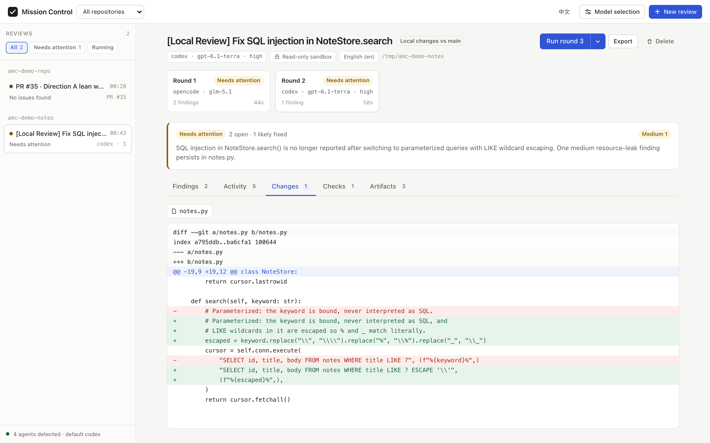
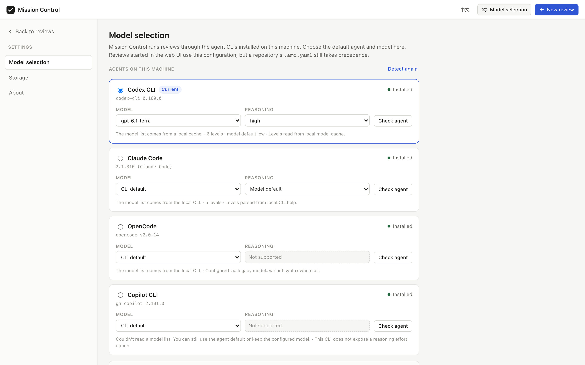

<h1 align="center">Mission Control</h1>

<p align="center">
  <strong>Review your changes with the coding agent you already use. Locally, before you push.</strong>
</p>

<p align="center">
  Drive Codex CLI, Claude Code, OpenCode, or Copilot CLI against uncommitted local changes or GitHub PRs, switch agent / model / reasoning effort per round, and track findings across rounds in a local-first workbench.
</p>

<p align="center">
  <a href="#quick-start"><strong>Quick start</strong></a> &nbsp;&middot;&nbsp;
  <a href="#show-what-matters"><strong>Workbench</strong></a> &nbsp;&middot;&nbsp;
  <a href="#how-it-works"><strong>How it works</strong></a> &nbsp;&middot;&nbsp;
  <a href="#cli-and-sdk"><strong>CLI &amp; SDK</strong></a> &nbsp;&middot;&nbsp;
  <a href="#honest-boundaries"><strong>Boundaries</strong></a> &nbsp;&middot;&nbsp;
  <a href="./README.zh-CN.md"><strong>简体中文</strong></a>
</p>

<p align="center">
  <a href="https://github.com/robll-v1/mission-control/actions/workflows/ci.yml"></a>
  <a href="https://www.python.org"></a>
  <a href="LICENSE"></a>
  <a href="#supported-agents"></a>
</p>

<p align="center">
  
</p>

<p align="center">
  <sub>Two-round local review on the bundled synthetic demo repository (<code>examples/first-review/make_demo_repo.py</code>): Round 1 ran on OpenCode, Round 2 switched to Codex (<code>high</code> reasoning) after a fix — the SQL injection moved to <code>Likely fixed</code> while the unclosed connection stayed <code>Persistent</code>.</sub>
</p>

---

## Quick start

Mission Control ships its React workbench inside the Python package. **No Node.js installation is required** to run `amc start`, and no extra API key or subscription is needed beyond the coding agent CLI already installed on your machine.

### 1. Launch the Web Workbench

Run directly without cloning (with [`uv`](https://docs.astral.sh/uv/)):

```bash
uvx --from git+https://github.com/robll-v1/mission-control.git amc start
```

Or install once with [`pipx`](https://pipx.pypa.io/):

```bash
pipx install git+https://github.com/robll-v1/mission-control.git
amc start
```

`amc start` binds strictly to `127.0.0.1`, stores state in your platform application data directory, and opens the workbench in your browser. Stop it cleanly anytime with `amc stop` (or check running ports with `amc status`).

### 2. Try a two-round review from the CLI (30 seconds)

```bash
# Generate the tiny synthetic repo with an SQL injection in notes.py
python3 examples/first-review/make_demo_repo.py /tmp/amc-demo-notes

# Round 1: review uncommitted local changes (structured JSON + CI exit code)
amc review --repo /tmp/amc-demo-notes --format json --exit-code

# Apply the parameterized query fix (still uncommitted) and re-review on another agent/reasoning
python3 examples/first-review/make_demo_repo.py /tmp/amc-demo-notes --apply-fix
amc review --repo /tmp/amc-demo-notes --backend codex --reasoning high
```

<details>
<summary>Development install from source (for contributors)</summary>

```bash
git clone https://github.com/robll-v1/mission-control.git
cd mission-control
python3 -m venv .venv && source .venv/bin/activate
pip install -e ".[dev]"

# Verify backend and frontend
pytest -q
cd frontend && npm ci && npx tsc --noEmit && npm test && npm run build
```

</details>

---

## Show what matters

| Switch agent, model &amp; reasoning per round | Inspect exact snapshots &amp; diffs | Dynamic local capability detection |
|---|---|---|
|  |  |  |
| Change agent, model, reasoning effort, output language, note, or focus for any round without creating a new review. | Uncommitted staged, unstaged, and untracked files are snapshotted into a temporary commit so the agent sees what is actually on disk. | Models and reasoning levels are read dynamically from your machine — never hardcoded — with a non-LLM `Check agent` static probe. |

---

## How it works

1. **Snapshot without touching your working tree.** For local changes, Mission Control copies your real git index to a temporary `GIT_INDEX_FILE`, writes a snapshot commit parented at `HEAD`, and creates an isolated git worktree from that snapshot. Your working files, index, and `HEAD` are never modified.
2. **Run your chosen agent with per-round settings.** Every round resolves `agent`, `model`, `reasoning`, `language`, `focus`, and `note` through a single layered `SettingsResolver` (`round > review > .amc.yaml > ~/.config/amc/config.yaml > default`), recording which layer supplied each value.
3. **Track findings as first-class state.** Agent output is parsed JSON-first (with Markdown fallback) into SQLite. Across rounds, each finding transitions through `New`, `Persistent`, `Unverified`, or `Likely fixed` (verified against the exact diff between `prev_round.snapshot_sha` and `curr_round.snapshot_sha`).
4. **Act on findings, then re-verify.** Copy a ready-to-paste fix prompt to your coding agent, jump directly to `file:line` via the allowlisted local `Open in editor` endpoint, run repository validation checks, and only you decide when to mark a finding `Resolved` or `Dismissed` (with full `Undo` and automatic reopen if a later round flags it again).

---

## Supported agents

| Agent | CLI | Model discovery | Reasoning effort | Read-only sandbox |
|---|---|---|---|---|
| **Codex CLI** | `codex` | Local `~/.codex/models_cache.json` / config | Per-model levels (`-c model_reasoning_effort=...`) | Yes (`--sandbox read-only`) |
| **Claude Code** | `claude` | Local CLI / config | Parsed from `claude --help` (`--effort ...`) | No (PATH guardrail only) |
| **OpenCode** | `opencode` | Local CLI / catalog cache | Legacy `provider/model#variant` alias | No (PATH guardrail only) |
| **Copilot CLI** | `gh copilot` | Agent default / config | Not exposed by CLI | No (PATH guardrail only) |

Default reasoning is always **`Model default`** (`null` — no reasoning flag passed). Switching agents never leaks the previous agent's model or reasoning setting.

---

## How it compares

| | Mission Control | [CodeRabbit](https://www.coderabbit.ai) | [GitHub Copilot Review](https://docs.github.com/en/copilot) | [PR-Agent](https://github.com/The-PR-Agent/pr-agent) |
|---|---|---|---|---|
| **Where it runs** | 100% local on your machine | Hosted SaaS (PR bot + CLI) | GitHub / VS Code | Self-hosted, primarily CI |
| **Models &amp; agents** | Any CLI agent &amp; model you already have; switchable per round | Vendor-managed | Vendor-managed | Bring your own API key |
| **Extra subscription** | None beyond your existing agent | Subscription | Copilot plan | Direct API usage |
| **Uncommitted local changes** | Yes (exact index + untracked snapshot) | Yes (CLI) | Yes (VS Code) | PR-focused |
| **Cross-round finding state** | `New / Persistent / Unverified / Likely fixed` + user `Resolved / Dismissed` | PR thread comments | PR thread comments | PR comments |
| **License** | MIT | Proprietary | Proprietary | Open source |

<sub>Based on public documentation; corrections welcome.</sub>

---

## CLI and SDK

### CLI (`amc`)

```bash
# Start / stop / inspect the local workbench
amc start [--port 8000] [--no-browser]
amc status
amc stop

# Static non-LLM check of installed CLI flags & reasoning levels
amc doctor

# Review uncommitted local changes or a GitHub PR
amc review
amc review https://github.com/org/repo/pull/123
amc review --backend codex --model gpt-6.1-terra --reasoning high --focus "security"
amc review --format json --exit-code

# Initialize global (~/.config/amc/config.yaml) or repo (.amc.yaml) config
amc init --global
amc init
```

### Python SDK

```python
from app.sdk import ReviewEngine

engine = ReviewEngine(language="en", backend="codex", reasoning="high")
report = engine.review("/path/to/repo")

if not report.passed:
    for f in report.findings:
        print(f"[{f.severity}] {f.path}:{f.line} — {f.summary}")
```

<details>
<summary>Configuration layers (<code>.amc.yaml</code>), storage paths, architecture &amp; archived MCP</summary>

### Configuration priority

```text
CLI flag (--model / --reasoning) > env (AMC_MODEL / AMC_REASONING) > repo .amc.yaml > global ~/.config/amc/config.yaml > agent default
```

Example `.amc.yaml`:

```yaml
repo:
  base_branch: main

backend:
  default: codex
  codex:
    model: gpt-6.1-terra
    reasoning: high

validation:
  default_mode: standard
  checks:
    tests:
      command: pytest -q
      modes: [standard, full]
      required: true
```

### Application data directory

Global configuration lives at `~/.config/amc/config.yaml` (honoring `XDG_CONFIG_HOME`). Runtime SQLite state, artifacts, and short-path isolated worktrees (`<data_dir>/wt/<task_id>`) live in your OS application data directory (`~/Library/Application Support/amc` on macOS, `~/.local/share/amc` on Linux, `%APPDATA%\amc` on Windows), overridable via `AMC_DATA_DIR`.

### Repository layout

```text
backend/app/
  cli.py                    amc start / stop / status / review / doctor / init / mcp
  sdk.py                    ReviewEngine Python SDK
  api/                      FastAPI routes, SSE EventBus stream, loopback Host/Origin security
  adapters/                 codex, claude-code, opencode, copilot CLI adapters
  core/                     SettingsResolver, ExecutionService, FindingTracker, EventBus, worktrees, process-tree cleanup
  services/                 Local snapshot, JSON-first result parser, safe Open-in-Editor, diff/summary export
  static/ui/                Bundled React workbench served directly by FastAPI
frontend/src/
  workbench/                Direction A lean workbench (default; legacy console kept at ?ui=legacy)
  i18n.ts                   English (default) and Simplified Chinese dictionaries
```

### MCP server (`amc mcp`)

The legacy stdio MCP server (`backend/app/mcp_server.py`) is currently archived and uses `mcp>=1.0.0,<2` in direct-API mode. Use `amc start`, `amc review`, or `ReviewEngine` for full multi-round tracking.

More documentation: [architecture &amp; sequence diagrams](docs/architecture-and-sequence-diagrams.md) &middot; [local snapshot design](docs/local-review-design.md) &middot; [project design history](docs/project-design-history.md)

</details>

---

## Honest boundaries

- **Listed models are not call guarantees.** Model and reasoning lists are discovered from local CLI caches, help output, or config files; only a real model request proves account access and quota.
- **PATH shims are guardrails, not an OS sandbox.** Only Codex CLI runs with an explicit `--sandbox read-only` flag (and the UI only displays the read-only sandbox badge when Codex is active).
- **Silence never equals fixed.** A finding omitted in a later round becomes `Unverified` (or `Likely fixed` if the code at that location changed between round snapshots) — never automatically `Resolved`.
- **Loopback-only local security.** The web server binds to `127.0.0.1`, enforces exact `Host`/`Origin` validation, restricts `Open in editor` to allowlisted native executables inside the resolved repository root, and disables repo-configured git commands (`core.fsmonitor`, hooks) during preflight status probes.

## License

[MIT](LICENSE)
