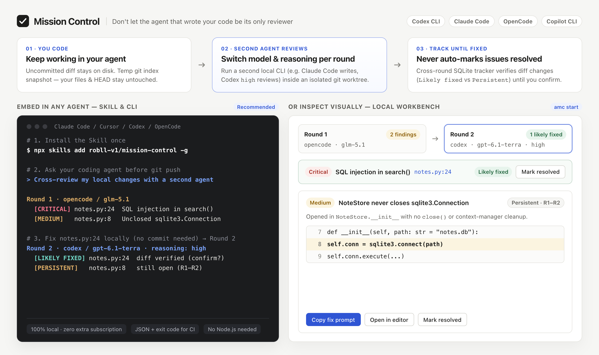
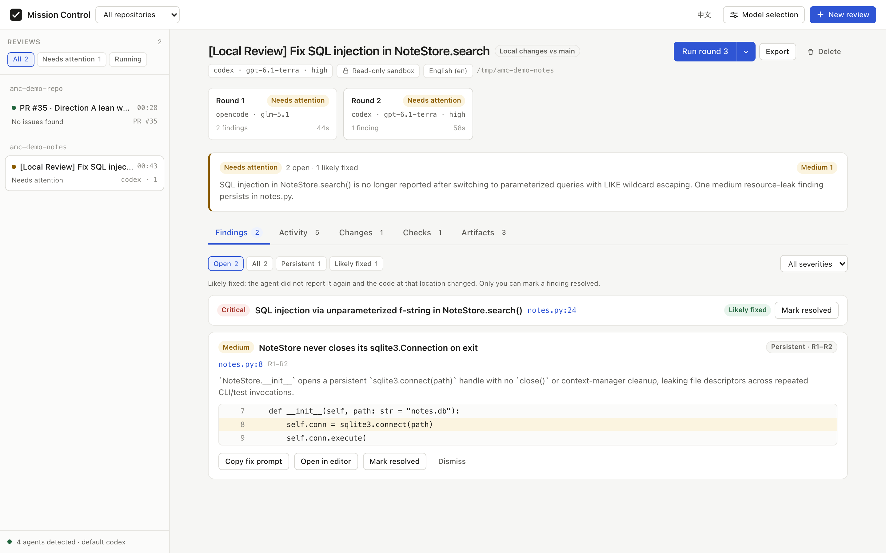
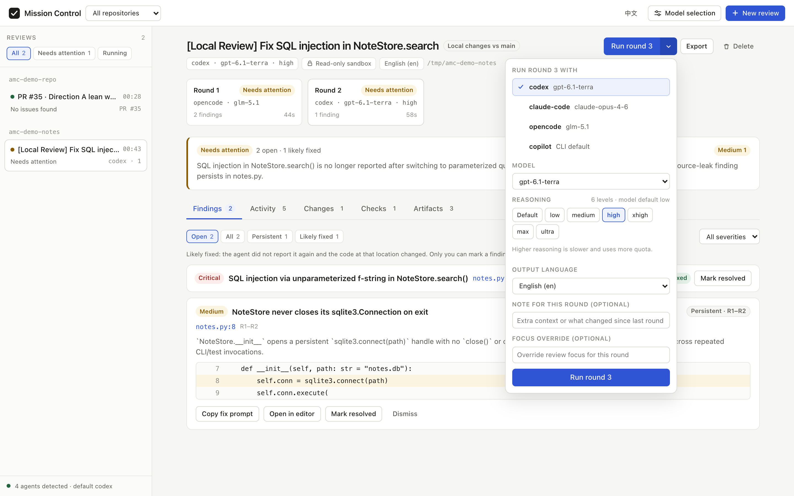

<h1 align="center">Mission Control</h1>

<p align="center">
  <strong>Don't let the agent that wrote your code be its only reviewer.</strong>
</p>

<p align="center">
  Cross-review uncommitted local changes or GitHub PRs with a second coding agent CLI already on your machine (Codex, Claude Code, OpenCode, or Copilot), and track every finding across rounds until it is actually fixed.
</p>

<p align="center">
  <a href="#quick-start"><strong>Quick start</strong></a> &nbsp;&middot;&nbsp;
  <a href="#why-not-just-ask-your-agent"><strong>Why cross-review</strong></a> &nbsp;&middot;&nbsp;
  <a href="#real-catch"><strong>Real catch</strong></a> &nbsp;&middot;&nbsp;
  <a href="#workbench-preview"><strong>Workbench</strong></a> &nbsp;&middot;&nbsp;
  <a href="#honest-boundaries"><strong>Boundaries</strong></a> &nbsp;&middot;&nbsp;
  <a href="./README.zh-CN.md"><strong>简体中文</strong></a>
</p>

<p align="center">
  <a href="https://github.com/robll-v1/mission-control/actions/workflows/ci.yml"></a>
  <a href="https://www.python.org"></a>
  <a href="LICENSE"></a>
  <a href="#supported-agents"></a>
</p>

<p align="center">
  
</p>

---

## Quick start

Embed directly into your coding agent via **Skill + CLI** (fastest path), or launch the **local Web Workbench** (no Node.js required).

### Option A: Agent Skill (embed in Claude Code / Codex / Cursor / OpenCode)

```bash
npx skills add robll-v1/mission-control -g
```

Then ask your coding agent before `git push`:

```text
Use mission-control to cross-review my local changes before I push, fix any confirmed issues, and re-review round 2.
```

The bundled skill ([`skills/mission-control/SKILL.md`](skills/mission-control/SKILL.md)) automatically picks a **different** installed CLI from the host agent (for example, Claude Code writes → Codex reviews), runs `amc review --format json` (falling back to `uvx` if `amc` is not installed globally), and loops cleanly until verified.

### Option B: CLI or Local Web Workbench (zero-clone with `uvx`)

```bash
# Review uncommitted local changes from the terminal (structured JSON + CI exit code)
uvx --from git+https://github.com/robll-v1/mission-control.git amc review --backend codex --reasoning high --format json --exit-code

# Or launch the local Web Workbench (bundled React UI, no Node.js needed)
uvx --from git+https://github.com/robll-v1/mission-control.git amc start
```

Prefer a permanent local install?

```bash
pipx install git+https://github.com/robll-v1/mission-control.git
amc review      # CLI review
amc start       # Web workbench on 127.0.0.1 (stop with `amc stop`)
amc doctor      # Non-LLM static check of installed agent flags & reasoning levels
```

<details>
<summary>Try the 30-second synthetic demo repo or install from source</summary>

```bash
# 30-second demo with an intentional SQL injection in notes.py
python3 examples/first-review/make_demo_repo.py /tmp/amc-demo-notes
amc review --repo /tmp/amc-demo-notes --format json --exit-code

# Apply the fix (stays uncommitted) and re-review on another agent/reasoning
python3 examples/first-review/make_demo_repo.py /tmp/amc-demo-notes --apply-fix
amc review --repo /tmp/amc-demo-notes --backend codex --reasoning high
```

Contributor install from source:

```bash
git clone https://github.com/robll-v1/mission-control.git
cd mission-control
python3 -m venv .venv && source .venv/bin/activate
pip install -e ".[dev]"
pytest -q
cd frontend && npm ci && npx tsc --noEmit && npm test && npm run build
```

</details>

---

## Why not just ask your agent?

| What goes wrong in chat ("review my changes") | What Mission Control does instead |
|---|---|
| **Same-model blind spots.** The agent that just wrote a patch tends to rationalize its own assumptions. | **Cross-agent per round.** Switch agent, model, and reasoning effort on any round (e.g. write in Claude Code, review on Codex `high`). |
| **Findings vanish between rounds.** When a second pass forgets to mention an earlier bug, you assume it is fixed. | **Cross-round state machine in SQLite.** Omitted findings become `Unverified`, or `Likely fixed` only when the exact diff between round snapshots modified that code — never auto-marked `Resolved`. |
| **Reviews drift from disk or mutate git state.** Reviewing only staged diffs misses untracked files and unstaged edits. | **Zero-touch local snapshots.** Copies your real index to a temporary `GIT_INDEX_FILE`, writes a snapshot commit parented at `HEAD`, and runs the reviewer in an isolated worktree. |

---

## Real catch

During development of Mission Control's own [PR #35](https://github.com/robll-v1/mission-control/pull/35) (Phase 6 workbench), cross-reviewing the patch with a second agent caught **4 P1 security and concurrency issues** before merge:

| Category | Bug caught before merge | Fix verified by tests |
|---|---|---|
| **Concurrency** | `DELETE /api/tasks/{id}` released its active check before worktree cleanup, racing with concurrent `start_task` and background `ValidationService`. | Unified per-task exclusive slot shared by start, validation, and delete + barrier-synchronized concurrency tests. |
| **Git safety** | Preflight `git status` on user-supplied paths could execute repo-configured `core.fsmonitor` commands and acquire index locks. | Enforced `--no-optional-locks` and disabled `core.fsmonitor`, `core.hooksPath`, `diff.external`, and LFS filters. |
| **Windows security** | Allowlisted editor names (`code`) resolve to `code.cmd` on Windows, allowing `cmd.exe` to parse untrusted repo filenames. | Required absolute native `.exe` binaries on Windows, `open -t` on macOS, and `shell=False`. |
| **Truthful UI** | Progress view labeled every backend as "Read-only sandbox" even when only Codex runs `--sandbox read-only`. | Scoped the sandbox badge strictly to Codex and tracked pending round specs during preflight. |

---

## Workbench preview

<p align="center">
  
</p>

| Switch agent, model &amp; reasoning per round | Inspect exact snapshots &amp; diffs | Dynamic local capability detection |
|---|---|---|
|  |  |  |
| Change agent, model, reasoning effort, output language, note, or focus for any round without creating a new review. | Review exact staged, unstaged, and untracked changes in the unified diff tab and jump straight to `file:line` in your editor. | Models and reasoning levels are read dynamically from your machine — never hardcoded — with a non-LLM `Check agent` probe. |

---

## Supported agents

| Agent | CLI | Model discovery | Reasoning effort | Read-only sandbox |
|---|---|---|---|---|
| **Codex CLI** | `codex` | Local `~/.codex/models_cache.json` / config | Per-model levels (`-c model_reasoning_effort=...`) | Yes (`--sandbox read-only`) |
| **Claude Code** | `claude` | Local CLI / config | Parsed from `claude --help` (`--effort ...`) | No (PATH guardrail only) |
| **OpenCode** | `opencode` | Local CLI / catalog cache | Legacy `provider/model#variant` alias | No (PATH guardrail only) |
| **Copilot CLI** | `gh copilot` | Agent default / config | Not exposed by CLI | No (PATH guardrail only) |

Default reasoning is always **`Model default`** (`null` — no reasoning flag passed). Switching agents never leaks the previous agent's model or reasoning setting.

---

## How it compares

| | Mission Control | [CodeRabbit](https://www.coderabbit.ai) | [GitHub Copilot Review](https://docs.github.com/en/copilot) | [PR-Agent](https://github.com/The-PR-Agent/pr-agent) |
|---|---|---|---|---|
| **Where it runs** | 100% local on your machine | Hosted SaaS (PR bot + CLI) | GitHub / VS Code | Self-hosted, primarily CI |
| **Models &amp; agents** | Any local CLI agent; switchable per round | Vendor-managed | Vendor-managed | Bring your own API key |
| **Extra subscription** | None beyond your existing agent | Subscription | Copilot plan | Direct API usage |
| **Uncommitted local changes** | Yes (index + untracked snapshot) | Yes (CLI) | Yes (VS Code) | PR-focused |
| **Cross-round finding state** | `New / Persistent / Unverified / Likely fixed` + user `Resolved / Dismissed` | PR thread comments | PR thread comments | PR comments |
| **License** | MIT | Proprietary | Proprietary | Open source |

<sub>Based on public documentation; corrections welcome.</sub>

---

## CLI, SDK &amp; Configuration

```bash
# CLI
amc review [PR_URL] [--repo PATH] [--backend codex|claude-code|opencode|copilot] [--model MODEL] [--reasoning LEVEL] [--focus TEXT] [--format json] [--exit-code]
amc start [--port 8000] [--no-browser]   # amc status / amc stop / amc doctor / amc init [--global]
```

```python
from app.sdk import ReviewEngine

engine = ReviewEngine(language="en", backend="codex", reasoning="high")
report = engine.review("/path/to/repo")
for f in report.findings:
    print(f"[{f.severity}] {f.path}:{f.line} — {f.summary}")
```

<details>
<summary>Configuration layers (<code>.amc.yaml</code>), storage paths, repository layout &amp; archived MCP</summary>

Priority: `CLI flag (--model / --reasoning) > env (AMC_MODEL / AMC_REASONING) > repo .amc.yaml > global ~/.config/amc/config.yaml > agent default`.

```yaml
repo:
  base_branch: main

backend:
  default: codex
  codex:
    model: gpt-6.1-terra
    reasoning: high

validation:
  default_mode: standard
  checks:
    tests:
      command: pytest -q
      modes: [standard, full]
      required: true
```

Global config lives at `~/.config/amc/config.yaml` (honoring `XDG_CONFIG_HOME`). SQLite state, artifacts, and short-path isolated worktrees (`<data_dir>/wt/<task_id>`) live in your OS application data directory (`~/Library/Application Support/amc` on macOS, `~/.local/share/amc` on Linux, `%APPDATA%\amc` on Windows), overridable via `AMC_DATA_DIR`.

The legacy stdio MCP server (`backend/app/mcp_server.py`) is archived and uses `mcp>=1.0.0,<2` in direct-API mode; use the Agent Skill, `amc review`, `amc start`, or `ReviewEngine` for full multi-round tracking.

More reading: [architecture &amp; sequence diagrams](docs/architecture-and-sequence-diagrams.md) &middot; [local snapshot design](docs/local-review-design.md) &middot; [project design history](docs/project-design-history.md)

</details>

---

## Honest boundaries

- **Listed models are not call guarantees.** Model and reasoning lists come from local CLI caches, help output, or config files; only a real request proves account access and quota.
- **PATH shims are guardrails, not an OS sandbox.** Only Codex CLI runs with `--sandbox read-only` (and the UI only shows the sandbox badge when Codex is active).
- **Silence never equals fixed.** Findings omitted in a later round become `Unverified` (or `Likely fixed` when code at that location changed between snapshots) — never automatically `Resolved`.
- **Loopback-only local security.** The server binds to `127.0.0.1`, enforces exact `Host`/`Origin` validation, restricts `Open in editor` to allowlisted native executables inside the resolved repository root, and disables repo-configured git commands (`core.fsmonitor`, hooks) during status probes.

## License

[MIT](LICENSE)
