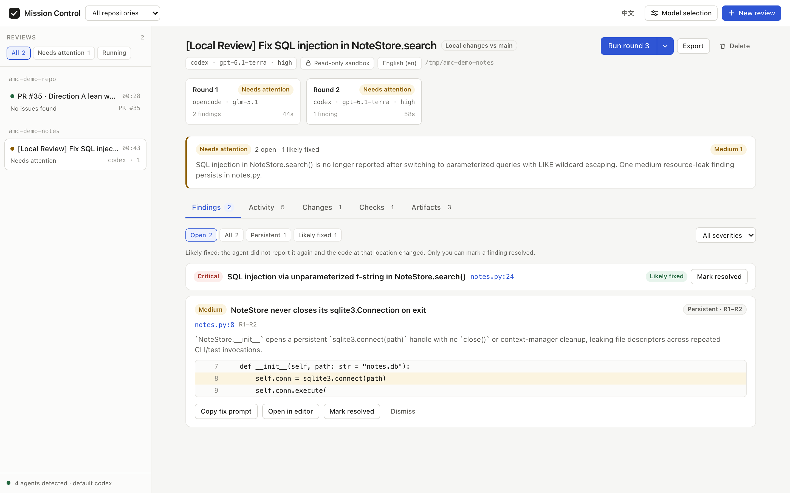
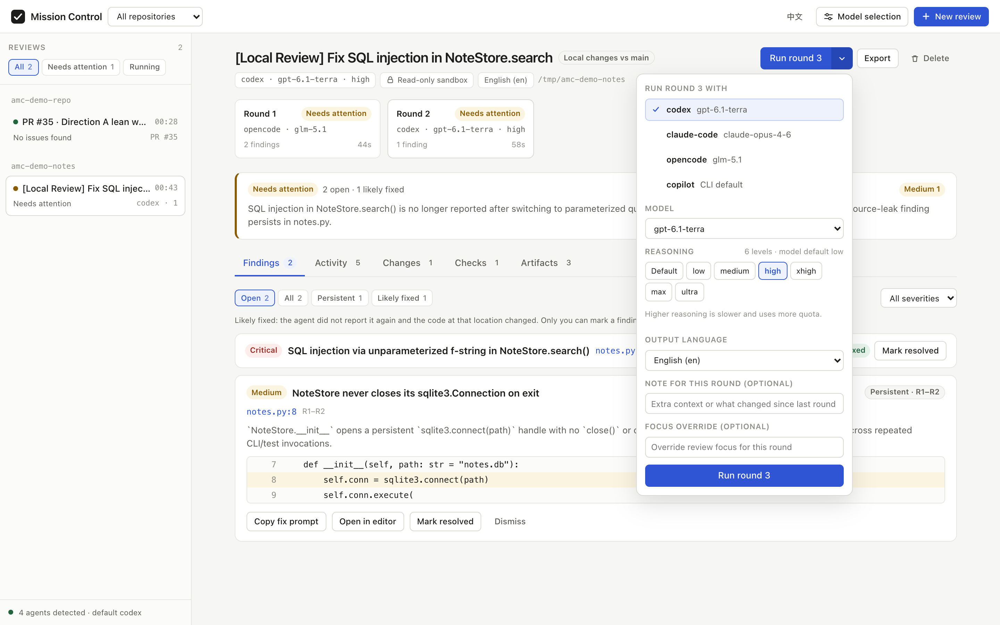
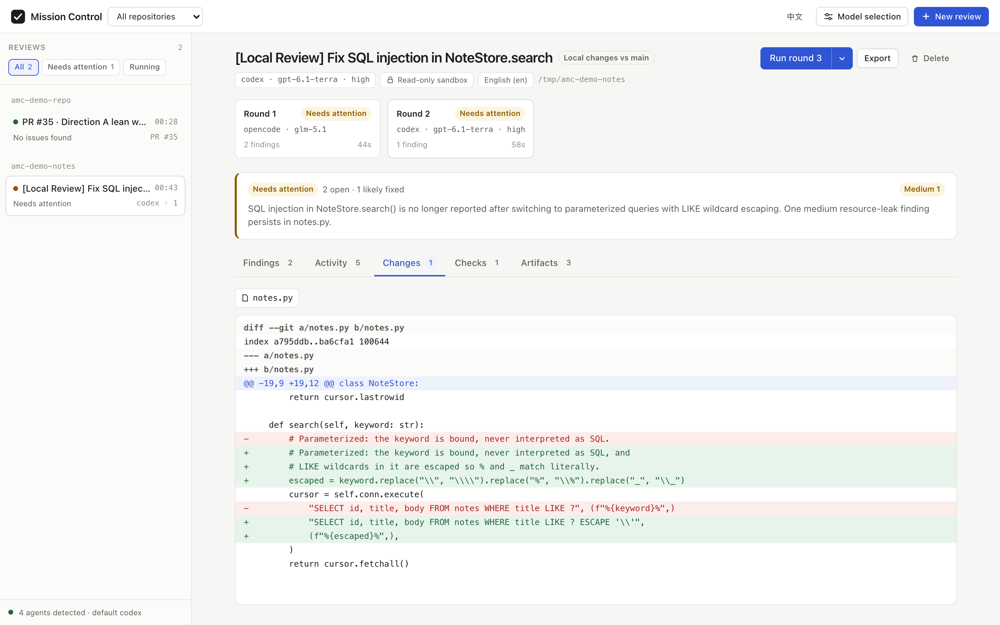
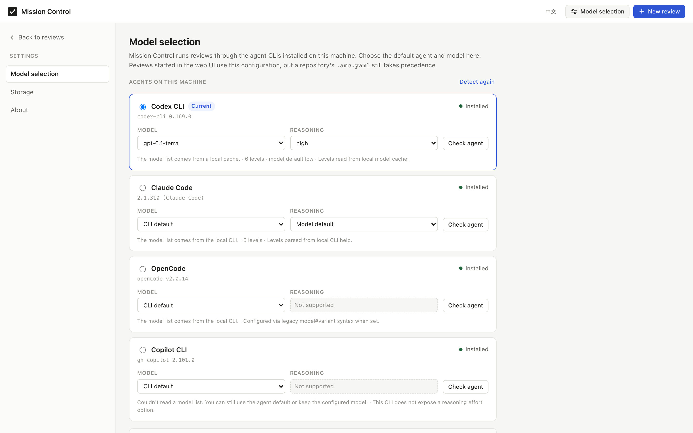

<h1 align="center">Mission Control</h1>

<p align="center">
  <strong>用你本机已有的 Coding Agent 审查代码改动。在推送之前，本地把关。</strong>
</p>

<p align="center">
  直接驱动你本机已安装的 Codex CLI、Claude Code、OpenCode 或 Copilot CLI 审查未提交的本地改动与 GitHub PR，支持每轮自由切换 Agent / 模型 / 推理强度，并在本地工作台中跨轮追踪每一个问题。
</p>

<p align="center">
  <a href="#快速开始"><strong>快速开始</strong></a> &nbsp;&middot;&nbsp;
  <a href="#核心特性"><strong>工作台特性</strong></a> &nbsp;&middot;&nbsp;
  <a href="#工作原理"><strong>工作原理</strong></a> &nbsp;&middot;&nbsp;
  <a href="#cli-与-python-sdk"><strong>CLI &amp; SDK</strong></a> &nbsp;&middot;&nbsp;
  <a href="#明确边界"><strong>能力边界</strong></a> &nbsp;&middot;&nbsp;
  <a href="./README.md"><strong>English</strong></a>
</p>

<p align="center">
  <a href="https://github.com/robll-v1/mission-control/actions/workflows/ci.yml"></a>
  <a href="https://www.python.org"></a>
  <a href="LICENSE"></a>
  <a href="#支持的-agent"></a>
</p>

<p align="center">
  
</p>

<p align="center">
  <sub>基于内置演示仓库（<code>examples/first-review/make_demo_repo.py</code>）的双轮本地审查界面示意：第 1 轮使用 OpenCode 发现问题，修复后第 2 轮切换至 Codex（<code>high</code> 推理强度）复审——SQL 注入转为 <code>Likely fixed</code>（仍需人工确认），未关闭连接保持 <code>Persistent</code>。</sub>
</p>

---

## 快速开始

Mission Control 已将 React 工作台直接打包进 Python 安装包中。**运行 `amc start` 无需安装 Node.js**，也无需额外购买订阅或向第三方服务交出 API Key——直接复用你本机已装好的 Coding Agent CLI。

### 1. 一行启动 Web 工作台

使用 [`uv`](https://docs.astral.sh/uv/) 零克隆直接运行：

```bash
uvx --from git+https://github.com/robll-v1/mission-control.git amc start
```

或使用 [`pipx`](https://pipx.pypa.io/) 安装到本机：

```bash
pipx install git+https://github.com/robll-v1/mission-control.git
amc start
```

`amc start` 默认仅绑定 `127.0.0.1`，将数据库、产物和隔离 worktree 存放在系统应用数据目录中，并在健康检查通过后自动打开浏览器。随时可用 `amc status` 查看状态、`amc stop` 优雅停止。

### 2. 30 秒体验 CLI 双轮审查

```bash
# 生成含合成 SQL 注入的极简演示仓库
python3 examples/first-review/make_demo_repo.py /tmp/amc-demo-notes

# 第 1 轮：审查未提交的本地改动（输出结构化 JSON 与 CI 退出码）
amc review --repo /tmp/amc-demo-notes --format json --exit-code

# 应用参数化查询修复（仍保持未提交），换另一个 Agent 和推理档位复审第 2 轮
python3 examples/first-review/make_demo_repo.py /tmp/amc-demo-notes --apply-fix
amc review --repo /tmp/amc-demo-notes --backend codex --reasoning high
```

<details>
<summary>从源码开发安装（贡献者）</summary>

```bash
git clone https://github.com/robll-v1/mission-control.git
cd mission-control
python3 -m venv .venv && source .venv/bin/activate
pip install -e ".[dev]"

# 运行后端与前端全量检查
pytest -q
cd frontend && npm ci && npx tsc --noEmit && npm test && npm run build
```

</details>

---

## 核心特性

| 每轮自由切换 Agent、模型与推理强度 | 精确快照与 Diff 视图 | 本机动态检测与静态自检 |
|---|---|---|
|  |  |  |
| 同一审查内，任意一轮都可单独改 Agent、模型、推理档位、输出语言、附言或关注点，无需重建任务。 | 将已暂存、未暂存和未跟踪文件拍成临时快照 commit，保证 Agent 读到的 patch 与工作区磁盘文件严格一致。 | 从本机缓存、CLI 帮助和配置文件动态读取模型与推理档位，绝不写死；内置不消耗额度的 `Check agent` 静态检查。 |

---

## 工作原理

1. **零侵入本地快照**：复制真实 git index 到临时 `GIT_INDEX_FILE`，生成父提交为 `HEAD` 的快照 commit，并基于该快照拉起隔离 git worktree。全程不触碰你的工作区文件、暂存区和 `HEAD`。
2. **按轮分层解析设置**：每一轮通过统一的 `SettingsResolver` 解析 `agent`、`model`、`reasoning`、`language`、`focus` 与 `note`（优先级：`本轮参数 > 审查默认 > 仓库 .amc.yaml > 全局 ~/.config/amc/config.yaml > 内置默认`），并明确标注每个字段的来源层。
3. **Finding 一等化与跨轮追踪**：优先解析 Agent 输出的 JSON 块（失败自动回退 Markdown 解析）并持久化至 SQLite。跨轮自动维护 `New`、`Persistent`、`Unverified` 与 `Likely fixed`（基于前后两轮 `snapshot_sha` 真实代码变动判定）。
4. **一键修复闭环**：每个问题支持一键复制修复提示词（`Copy fix prompt`）、通过受控白名单在本地编辑器中直达 `file:line`（`Open in editor`）、运行仓库验证检查（`Checks`），并仅由用户决定标为 `Resolved` 或 `Dismissed`（支持撤回，且若后续轮次再次报出已解决项会自动重开）。

---

## 支持的 Agent

| Agent | CLI | 模型发现来源 | 推理强度（Reasoning） | 只读沙箱 |
|---|---|---|---|---|
| **Codex CLI** | `codex` | 本机 `~/.codex/models_cache.json` / 配置 | 按模型读取档位（`-c model_reasoning_effort=...`） | 支持（`--sandbox read-only`） |
| **Claude Code** | `claude` | 本机 CLI / 配置 | 从 `claude --help` 解析（`--effort ...`） | 否（仅 PATH 护栏） |
| **OpenCode** | `opencode` | 本机 CLI / catalog 缓存 | 兼容历史 `provider/model#variant` 别名 | 否（仅 PATH 护栏） |
| **Copilot CLI** | `gh copilot` | Agent 默认 / 配置 | CLI 未暴露该参数 | 否（仅 PATH 护栏） |

推理强度默认始终为 **`Model default`**（`null`，不向 CLI 传参）；切换 Agent 时不会把上一个 Agent 的模型或档位串给下一个 Agent。

---

## 与同类工具对比

| | Mission Control | [CodeRabbit](https://www.coderabbit.ai) | [GitHub Copilot Review](https://docs.github.com/en/copilot) | [PR-Agent](https://github.com/The-PR-Agent/pr-agent) |
|---|---|---|---|---|
| **运行位置** | 100% 运行在你本机 | 云端托管（PR Bot + CLI） | GitHub / VS Code | 自托管，偏 CI 场景 |
| **模型与 Agent** | 复用本机任意已装 CLI；支持每轮切换 | 平台选定 | 平台选定 | 自备 API Key |
| **额外费用** | 除现有 Agent 外无任何额外订阅 | 订阅制 | Copilot 套餐 | 按 API 用量计费 |
| **未提交本地改动** | 支持（含暂存/未暂存/未跟踪快照） | 支持（CLI） | 支持（VS Code） | 偏 PR 审查 |
| **跨轮问题状态** | `New / Persistent / Unverified / Likely fixed` + 人工 `Resolved / Dismissed` | PR 评论串 | PR 评论串 | PR 评论 |
| **协议** | MIT 开源 | 闭源 | 闭源 | 开源 |

<sub>以上对比整理自公开文档，如有出入欢迎提交 PR 修正。</sub>

---

## CLI 与 Python SDK

### 命令行（`amc`）

```bash
# 启动 / 查看 / 停止本地工作台
amc start [--port 8000] [--no-browser]
amc status
amc stop

# 不调用大模型的静态自检（检查 CLI 版本、参数与推理档位）
amc doctor

# 审查当前仓库未提交改动或指定 GitHub PR
amc review
amc review https://github.com/org/repo/pull/123
amc review --backend codex --model gpt-6.1-terra --reasoning high --focus "security"
amc review --format json --exit-code

# 初始化全局（~/.config/amc/config.yaml）或仓库级（.amc.yaml）配置
amc init --global
amc init
```

### Python SDK

```python
from app.sdk import ReviewEngine

engine = ReviewEngine(language="en", backend="codex", reasoning="high")
report = engine.review("/path/to/repo")

if not report.passed:
    for f in report.findings:
        print(f"[{f.severity}] {f.path}:{f.line} — {f.summary}")
```

<details>
<summary>配置分层（<code>.amc.yaml</code>）、存储路径、架构目录与归档 MCP 说明</summary>

### 配置优先级

```text
命令行参数（--model / --reasoning）> 环境变量（AMC_MODEL / AMC_REASONING）> 仓库 .amc.yaml > 全局 ~/.config/amc/config.yaml > Agent 默认
```

`.amc.yaml` 示例：

```yaml
repo:
  base_branch: main

backend:
  default: codex
  codex:
    model: gpt-6.1-terra
    reasoning: high

validation:
  default_mode: standard
  checks:
    tests:
      command: pytest -q
      modes: [standard, full]
      required: true
```

### 数据与配置目录

全局配置位于 `~/.config/amc/config.yaml`（遵循 `XDG_CONFIG_HOME`）。SQLite 数据库、审查产物与短路径隔离 worktree（`<data_dir>/wt/<task_id>`）保存在系统应用数据目录（macOS `~/Library/Application Support/amc`、Linux `~/.local/share/amc`、Windows `%APPDATA%\amc`），可通过 `AMC_DATA_DIR` 覆盖。

### 仓库结构

```text
backend/app/
  cli.py                    amc start / stop / status / review / doctor / init / mcp
  sdk.py                    ReviewEngine Python SDK
  api/                      FastAPI 路由、SSE EventBus 实时流、本机 Host/Origin 安全校验
  adapters/                 codex / claude-code / opencode / copilot CLI 适配器
  core/                     SettingsResolver、ExecutionService、FindingTracker、EventBus、worktree 与进程树清理
  services/                 本地快照、JSON 优先结果解析、安全 Open-in-Editor、Diff/摘要导出
  static/ui/                随 Python 包内置分发的 React 工作台静态产物
frontend/src/
  workbench/                方向 A 精简版工作台（默认界面；旧版保留在 ?ui=legacy）
  i18n.ts                   英文（默认）与简体中文双语词典
```

### MCP 服务（`amc mcp`）

旧版 stdio MCP 服务（`backend/app/mcp_server.py`）目前处于归档状态，依赖 `mcp>=1.0.0,<2` 并走 direct-API 模式。日常多轮追踪请优先使用 `amc start`、`amc review` 或 `ReviewEngine`。

延伸阅读：[架构与时序图](docs/architecture-and-sequence-diagrams.md) &middot; [本地快照设计](docs/local-review-design.md) &middot; [项目设计历程](docs/project-design-history.md)

</details>

---

## 明确边界

- **列出模型不等于账号一定可调用**：模型与推理档位均来自本机缓存、帮助信息或配置文件，只有真实调用才能验证账号权限与额度。
- **PATH shim 是护栏而非系统沙箱**：目前仅 Codex CLI 启用 `--sandbox read-only`，界面也只在当前轮使用 Codex 时展示只读沙箱标签。
- **未再提及不等于已修复**：后续轮次未再报出的问题只会被标为 `Unverified`（或在对应位置代码发生变动时标为 `Likely fixed`），系统绝不会自动标为 `Resolved`。
- **严格本地回环安全**：Web 服务默认仅监听 `127.0.0.1` 并校验精确 `Host`/`Origin`；`Open in editor` 仅允许白名单原生可执行文件打开仓库根目录内的常规文件；仓库预检禁用 `core.fsmonitor` 等仓库配置外部命令并关闭可选索引锁写入。

## 许可证

[MIT](LICENSE)
