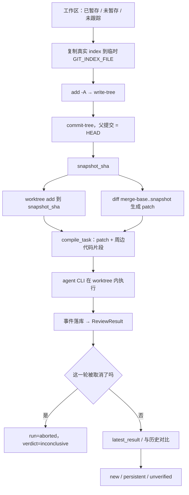

# 为什么"把 git diff 丢给模型"不够

> 技术文章草稿，用于作品集与面试讲解。
> 代码基线：`7a093bd`（`main`，含 PR #21）。文中所有路径与函数名都在该提交上存在。

## 起点：一个最小实现能跑，但结论不可信

最小实现通常只有三行：读 `git diff`，拼进 prompt，打印模型输出。它能给出结论，但结论所描述的那个版本，可能在任何时刻都没有存在过。

设想一个例子（用于说明设计问题，不是某次真实事故的记录）：某文件先被 `git add` 成 A，随后又被改成 B。`git diff` 只显示 B 相对 A，`git diff --cached` 只显示 A 相对 HEAD，两段拼起来，就会出现一个从未存在过的中间态。

## 输入不是一个 diff，而是三份现实

`git diff` 只看未暂存；`git diff --cached` 只看已暂存；未跟踪文件两者都不包含。把三段拼起来听上去可行，但拼接顺序本身就会造出上面那个中间态。

就算 patch 拼对了还有第二个问题：agent 在一个目录里工作，会自己打开文件。patch 说第 40 行是 `x`，文件里是 `y`，结论就会漂。这不是模型不聪明，是两份输入不一致。

此外还有时间：patch 是 T0 的快照，文件是 T1 的状态，中间你可能一直在敲键盘。

## 冻结输入：临时 index → 快照 commit → 隔离 worktree

解决办法不是更小心地拼字符串，而是**把工作区变成一个真实的 commit**，让 patch 和文件天然同源（`local_review_service.py` 的 `capture_local_snapshot`）：

1. 用 `mkstemp` 造一个临时文件，设成子进程的 `GIT_INDEX_FILE`（`:91`）；
2. 把仓库**真实 index** 复制过去（`:104-105`）。没有真实 index 时才 `read-tree HEAD` 兜底；
3. 排除 `.amc/reviews` 和运行时生成目录（数据库、artifacts、worktrees），避免把框架自己的产物审进去；
4. 在这个临时 index 上 `add -A` → `write-tree` → `commit-tree`，**父提交是当前 HEAD**（`:127-140`）；
5. 用 `merge-base(base, HEAD)..snapshot` 生成 patch（`--binary --find-renames`，并关掉 `core.quotepath`）。

关键在第 2 步和第 4 步：所有对 index 的写操作都发生在临时文件上，`git commit-tree` 也不移动任何 ref。用户的 index、`HEAD`、工作区全程不变——`test_local_snapshot.py:24` 就是直接在测试里断言 `write-tree` 和 `diff --cached --binary` 前后完全一致。

父提交选 HEAD 是刻意的：本地 diff 与 PR 语义同构，`compile_task` 不用写两套解析。

然后是 worktree：`worktree.py:146-161` 的 `_resolve_revision` 对本地任务只认 `task.local_snapshot_sha`，`ensure_worktree` 发现 revision 不符会先清理再重建。agent 的 `cwd` 因此是**那个快照 commit 的检出**，它读到的 patch 和能 `cat` 的文件必然一致（`test_local_snapshot.py:90`）。

每轮开始前还会重拍快照（`execution.py:699-741` 的 `_refresh_local_snapshot`）：改完代码再点第二轮，审的是新状态。

**取舍**：快照 commit 是游离对象，不进任何分支，靠 git 自身对象存活期。它保证的是**快照生成之后**三者一致——快照内容、由它 diff 出的 patch、agent 在 worktree 里打开的文件指向同一个 commit；但它不是事务：`add -A` 经 `write-tree` 到 `commit-tree` 这段时间若有人并发写文件，读到的内容可能新旧混杂，这一点没有原子性保证。另外只覆盖父仓库工作区，子模块内部未提交改动不在里面。

## Task / Run / ReviewResult：三个时间尺度

第二层设计是把"审查"拆成三个对象（`backend/app/core/models.py:43-94`）：

- **Task** 是审查对象：来源（PR / local）、base、快照 sha、改动文件列表。它是稳定的，重试十次也只有一个 Task。
- **Run** 是一次执行：`round_index`、backend、状态、耗时、各类 metrics、后端 session id。每点一次"开始"就多一条。
- **ReviewResult** 是一轮结论：verdict、findings、`source_event_seq`、`supersedes_round_index`。

为什么不合并？它们的生命周期不一样：重试要保留上一轮的失败原因，取消要能定位"第几轮"，崩溃恢复只该修运行态、不能动结论，历史对比要的是轮次粒度。

这里有个**必须讲清楚的语义差异**：Web 界面显示的是 `ReviewResultService.latest_result()` 的结果，也就是"最新一个产出了结构化结论的轮次"（`review_result_service.py:130-137`），它**不做跨轮聚合**；而 SDK 在 `incremental=True` 时会把上一轮未被提及的问题并进这一轮的报告里（`backend/app/sdk.py:494-520`）。两者都合理，但不是同一件事。

## 取消：为什么必须跨"读—改—写"同步

取消看起来只是 `kill` 一下，实际是个并发正确性问题，因为有两方在改同一行状态：HTTP 线程调 `abort_task`，worker 线程在进程退出后写结果。

如果只做"读 task.status → 判断 → 写入"，中间那个窗口足够让收尾逻辑把 `ABORTED` 覆盖成 `FAILED`，或者反过来，让一次已完成的审查被迟到的取消标成中止。

现在的做法是**先发布意图，再终止进程**：`abort_task`（`execution.py:224-245`）在 `db.locked()` 里同时完成"置 ABORTED + 记 `control.accepted` 事件"，然后才发 SIGTERM；worker 的 `_persist_round_result`（`:247-269`）在同一把锁里读状态、决定是否覆盖。锁是 `RLock`（`core/db.py:36`），所以嵌套调用不会自锁。

再加两道保险：`MissionEngine.set_stage` 拒绝把 ABORTED 改成任何状态（除非开新一轮，`mission_engine.py:67-86`）；被取消的 run 在解析结论时强制 `inconclusive`（`review_result_service.py:221-223`），避免半截输出里那句"未发现明显问题"被当成 `clear`——`test_abort_semantics.py:162` 就是专门钉这个的。

`Database` 用单连接 + `RLock` 也不是偷懒：`check_same_thread=False` 只关掉 Python 的所有权检查，`Connection.execute()` 建游标和 step 是两次操作，跨线程交错会出 `IndexError`。所以"读—改—写"必须显式包进 `locked()`，不能指望 GIL。

## 增量：没被提到，不等于已修复

增量审查最容易犯的错，是把"这一轮模型没再说"当成"已经修好"。

`ReviewHistoryStore.compare_findings`（`services/review_history.py:185-238`）只产出三类：`new`、`persistent`、`unverified`。指纹是 `severity|path|summary[:40]`，匹配用加权相似度（同文件 0.3、同行号 0.2、摘要相似 0.3、同严重程度 0.2），阈值 0.6。**没匹配上的上一轮问题一律进 `unverified`**，而且会被写回历史、计入严重程度统计，必要时把 `clear` 抬成 `concerns`（`sdk.py:512-520`）。

只有 `incremental=False` 的完整审查，才会用"只有本轮 findings"的记录覆盖历史，等于清空旧账。

这里我要主动交代一个**没做完的地方**：`ReviewReport.resolved_findings` 目前恒为空——`sdk.py:491` 把它初始化为 `[]` 之后没有任何地方再写入；`check_code_modified()` 虽然有实现（批量解析 `git diff -U0` 的行区间），但**没有任何调用方**（全仓只有定义）。所以任何下游想把某条 finding 显示成"已解决"，拿到的都只会是空列表。这是一个会说谎的接口。我没有在这次改动里把它接上——"代码行被改过"离"问题被修好"还有距离，随手接上只会制造新的过度承诺。要么补真实验证，要么删掉这个字段。

## 一张图

## 边界：它不是什么

- **不是沙箱。** PATH 前面插空操作 shim 只能拦住裸命令，绝对路径直接绕过（`core/review_policy.py:38-77` 的注释写得很直白）。它防误操作，不防恶意代码。
- **不是离线推理。** 框架不调模型，agent CLI 会调自己的服务商，断网一样跑不了。
- **不保证账号可用。** 模型、额度、限流都归 CLI 和你的订阅管。
- **不覆盖子模块。** 父仓库快照不包含子模块内部的未提交改动。
- **准备阶段取消不生效。** `abort_task` 在进程还没拉起时（`process is None`）返回 `False`，那一小段时间只能等它进入运行态。
- **Web 与 SDK 语义不同。** 见上文，别当成同一个"多轮审查"。
- **SSE 是轮询。** `routes_stream.py` 每秒全量 `list_events` 再取增量，事件多时是浪费。
- **Windows 未实机验证。** 进程用 `CREATE_NEW_PROCESS_GROUP` 创建，终止走 `terminate` / `kill`，只有 CI 覆盖。

## 证据清单

| 结论 | 测试 |
|---|---|
| 快照不碰真实 index / HEAD，且含重命名、空格与中文路径 | `test_local_snapshot.py:24` |
| worktree 内容与 compile 出的 patch 一致 | `test_local_snapshot.py:90` |
| 每轮重拍快照，第二轮能看到新改动 | `test_local_snapshot.py:157` |
| 并发 start 只跑一轮 | `test_execution_concurrency.py:71` |
| 取消不会被 worker 收尾覆盖 | `test_abort_semantics.py:41`、`:125` |
| 被取消的输出不能判 clear | `test_abort_semantics.py:162` |
| 未提及的旧问题保持 unverified，完整审查才清空 | `test_sdk_and_db.py:135` |
| PR 历史不污染本地增量 | `test_sdk_and_db.py:175`、`:219` |

## 一句话总结

这个项目真正解决的问题不是"调模型审代码"，而是**让被审的东西、模型读到的 patch、以及最后写进历史的结论，始终指向同一个可复现的状态**。输入一致性和状态机正确性，比 prompt 技巧难得多，也更值得讲。
